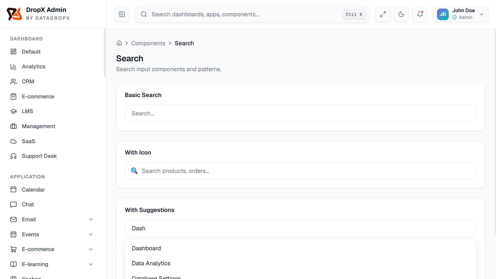

# DropX Admin — Laravel 12 + React 19 + TypeScript + Tailwind CSS v4

A modern, full-stack Admin & Dashboard application converted from **DropX Admin** (originally Next.js 16) into a unified **Laravel 12** backend with a high-performance **React 19**, **TypeScript**, and **Tailwind CSS v4** SPA frontend powered by **Vite** and **React Router**.

---

## 🚀 Tech Stack

| Layer | Technology | Details |
|---|---|---|
| **Backend Framework** | Laravel 12.x | Modern PHP 8.2+ / 8.5 architecture |
| **Frontend Framework** | React 19.x & React Router 7.x | Full Client SPA with code splitting & lazy loading |
| **Language** | TypeScript | Strict type checking & interfaces |
| **Styling** | Tailwind CSS v4 & PostCSS | Theme tokens, custom dark variant, animations |
| **State Management** | Redux Toolkit & React-Redux | Global UI state (sidebar, theme, layout) |
| **Icons & Charts** | Lucide React & Recharts | Modern interactive charts & responsive icon set |
| **Build Tool** | Vite + Laravel Vite Plugin | Fast HMR and sub-second builds |
| **Database** | SQLite / MySQL | Pre-configured SQLite (`database/database.sqlite`), ready for MySQL |

---

## 📸 Project Preview




---

## 📁 Project Structure

```
dropx-admin/
├── app/                        # Laravel Controllers, Models, Middleware, Providers
├── bootstrap/                  # Laravel application bootstrap & configuration
├── config/                     # Laravel config files
├── database/                   # Migrations, seeders, factories, SQLite database
├── public/                     # Public assets, brand icons, favicons, Vite build output
├── resources/
│   ├── css/
│   │   └── globals.css         # Tailwind CSS v4 design tokens and theme styling
│   ├── js/
│   │   ├── components/         # Reusable UI & layout components (Sidebar, Header, etc.)
│   │   ├── config/             # Navigation schema and site metadata
│   │   ├── data/               # Mock data sources (CRM, Ecommerce, LMS)
│   │   ├── lib/                # Chart theme, utility functions, formatting
│   │   ├── pages/              # Admin pages, modules, utilities, auth pages
│   │   ├── routes/             # React Router route definitions
│   │   ├── shims/              # Clean shims for Next.js features (Link, Router, Theme)
│   │   ├── store/              # Redux Toolkit store and slices
│   │   ├── types/              # TypeScript types and definitions
│   │   ├── App.tsx             # Root application component with Providers
│   │   └── main.tsx            # React 19 DOM entry point
│   └── views/
│       └── app.blade.php       # Single Blade view hosting the React application
├── routes/
│   ├── web.php                 # SPA fallback route (`Route::view('/{any?}', 'app')`)
│   └── console.php             # Artisan console commands
├── storage/                    # Laravel logs, framework cache, sessions
├── .env                        # Environment variables
├── artisan                     # Laravel CLI runner
├── composer.json               # PHP Composer dependencies
├── package.json                # Node/npm frontend dependencies
├── tsconfig.json               # TypeScript path aliases & compiler options
└── vite.config.ts              # Vite + Laravel Vite Plugin + React configuration
```

---

## ⚡ Quick Start & Development

### 1. Requirements
- **PHP** 8.2 or higher
- **Composer** 2.x
- **Node.js** 20.x or higher
- **npm** or **yarn**

### 2. Environment Setup
The environment file `.env` and SQLite database are already prepared:
```bash
# If setting up fresh on another machine:
cp .env.example .env
php artisan key:generate
php artisan migrate --force
npm install --legacy-peer-deps
```

### 3. Running Development Servers
You can run the Laravel server and Vite frontend concurrently or in separate terminals:

**Terminal 1 — Laravel Server:**
```bash
php artisan serve
# Runs on http://127.0.0.1:8000
```

**Terminal 2 — Vite Dev Server (HMR):**
```bash
npm run dev
# Runs on http://localhost:5173 with instant Hot Module Replacement
```

Open `http://localhost:8000` in your browser.

---

## 🏗️ Production Build

To build optimized production assets:
```bash
npm run build
```
Vite bundles all assets into `public/build/` with a manifest file ready for Laravel's `@vite()` Blade directive.

---

## 🎨 Design System & Theme Support

- **Light & Dark Mode**: Persistent theme switching (`light`, `dark`, `system`) with smooth transitions and zero layout shifts.
- **Tailwind CSS v4**: Inline theme variables, custom color palette, responsive typography (`--text-2xs`), and border radius scale.
- **Interactive UI**: Recharts data visualizations, Leaflet maps, advanced data tables, animated counters, and Sonner toast notifications.

---

## 📜 Credits & License
- Originally designed & developed by **[DataDropX](https://datadropx.net)**.
- Converted to **Laravel 12 + React 19** architecture for full-stack deployment.
